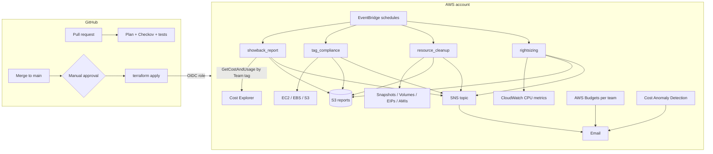
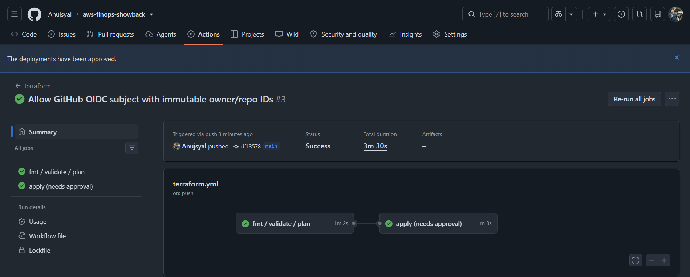
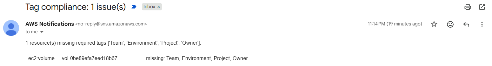
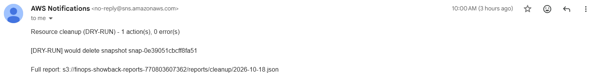
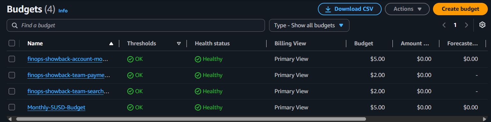
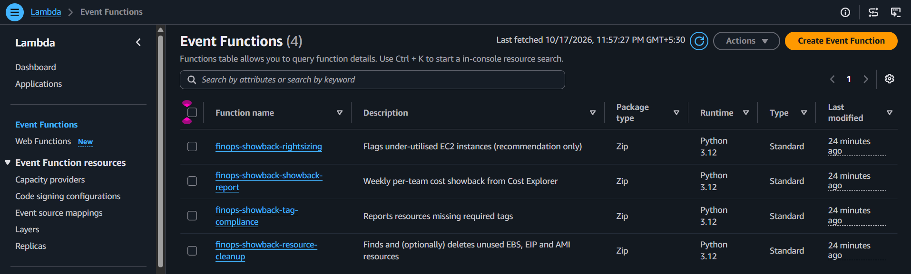
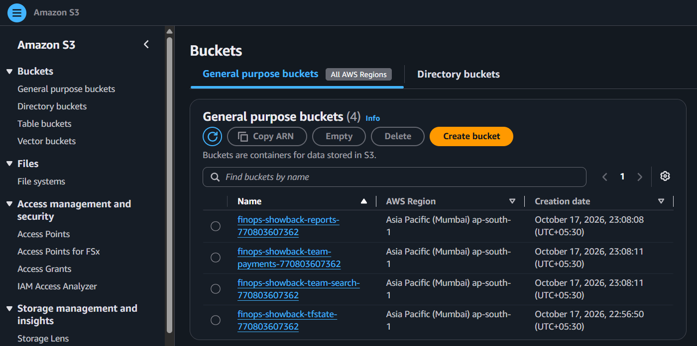

# AWS FinOps Showback Platform

Charge AWS spend back to the teams that create it, catch untagged resources,
delete waste automatically and recommend rightsizing. Everything is built with
**Terraform**, **Python (Boto3) Lambdas** and deployed through **GitHub Actions
with OIDC** (no AWS keys stored anywhere).

   

## Architecture



## Features

| Capability | How |
|---|---|
| **Tag enforcement** | Provider `default_tags` + a Lambda that scans EC2, EBS, snapshots and S3 for missing `Team / Environment / Project / Owner` tags |
| **Showback** | Weekly Lambda queries Cost Explorer grouped by the `Team` tag, saves CSV to S3, emails a per-team summary |
| **Budgets** | Account budget + one budget per team (filtered by tag), alerts at 80% actual and 100% |
| **Anomaly alerts** | Cost Anomaly Detection monitor with daily email above a $ threshold |
| **Automated cleanup** | Orphan snapshots, unattached volumes, idle Elastic IPs, old AMIs. **Dry-run by default**, `Keep=true` tag always skipped |
| **Rightsizing** | Flags instances with avg CPU < 10% over 14 days and suggests a smaller type. Recommendation only, no auto-resize |
| **CI/CD** | GitHub Actions: `fmt`, `validate`, Checkov policy scan, plan as a PR comment, apply behind an environment approval gate |
| **Least privilege** | One IAM role per Lambda; the CI role can only manage IAM roles prefixed with the project name |

## Repository layout

```
aws-finops-showback/
├── terraform/
│   ├── bootstrap/            # one-time: state bucket + GitHub OIDC role
│   ├── modules/team/         # demo resources for one team
│   ├── lambdas.tf            # 4 Lambdas, IAM, log groups, schedules
│   ├── budgets_and_anomalies.tf
│   ├── storage_and_alerts.tf # reports bucket + SNS
│   └── demo_resources.tf     # fake teams + one untagged test volume
├── lambdas/
│   ├── showback_report/
│   ├── tag_compliance/
│   ├── resource_cleanup/
│   └── rightsizing/
├── tests/                    # pytest unit tests (no AWS needed)
├── scripts/                  # invoke a Lambda, create test waste
└── .github/workflows/        # terraform.yml, python-ci.yml
```

## Setup

### Prerequisites
- AWS account with a **$5 billing alert** already set (do this first)
- An IAM user (not root) with admin rights for the one-time bootstrap, configured with `aws configure`
- Terraform >= 1.13, AWS CLI v2, Python 3.12, Git

### 1. Bootstrap (once, from your laptop)
```bash
cd terraform/bootstrap
terraform init
terraform apply -var="github_repo=<your-github-user>/aws-finops-showback"
```
Note the two outputs: `state_bucket` and `github_actions_role_arn`.

### 2. Configure the GitHub repo
**Settings → Secrets and variables → Actions → Variables**:

| Variable | Value |
|---|---|
| `AWS_ROLE_ARN` | `github_actions_role_arn` output |
| `TF_STATE_BUCKET` | `state_bucket` output |
| `ALERT_EMAIL` | your email |
| `AWS_REGION` | `ap-south-1` |

**Settings → Environments → New environment `production`** → add yourself as a *required reviewer*. This is the manual approval gate.

### 3. First deploy
Either push to `main` (GitHub Actions plans, waits for your approval, then applies), or run locally:
```bash
cd terraform
cp terraform.tfvars.example terraform.tfvars   # set alert_email
terraform init -backend-config="bucket=<state_bucket>" \
  -backend-config="key=finops-showback/terraform.tfstate" \
  -backend-config="region=ap-south-1" -backend-config="use_lockfile=true"
terraform plan
terraform apply
```

### 4. Confirm the SNS email
AWS sends a "Subscription Confirmation" email. Click the link, otherwise no reports arrive.

### 5. Try it
```bash
./scripts/invoke.sh tag-compliance     # should report the untagged test volume
./scripts/create_test_waste.sh         # creates an orphan snapshot + unattached volume
./scripts/invoke.sh resource-cleanup   # dry-run report of what would be deleted
./scripts/invoke.sh showback-report    # per-team cost (needs step 6 first)
```

### 6. Activate cost allocation tags (24-48h after first apply)
AWS only lets you activate a tag after it has appeared in billing data. After a day or two, set `activate_cost_allocation_tags = true` and apply. Tag-based costs show up in Cost Explorer within another 24h. Until then the showback report groups everything under `(untagged)`, which is expected.

### 7. Go live with cleanup
After reading a few dry-run reports, set `cleanup_dry_run = false`.

## Cost

Designed to stay close to **$0**:
- Lambda, EventBridge, SNS, S3 → within free tier
- Cost Explorer API → $0.01 per call, called once a week (~$0.05/month)
- 1 GiB EBS volumes + snapshots → a few cents
- Budgets → first 2 free; the 3rd costs ~$0.02/day (set `team_budgets_enabled = false` to avoid it)
- No NAT Gateway, no public IPs, EC2 off by default (`demo_ec2_enabled = false`)
- Log retention 14 days, reports expire after 90 days

**Tear down when done:**
```bash
cd terraform && terraform destroy
cd bootstrap && terraform destroy   # empty the state bucket first
```

## Design decisions

- **Dry-run by default for deletion.** A cleanup bot that deletes the wrong snapshot is worse than no bot.
- **Rightsizing is recommendation-only.** Resizing needs a stop/start; a human should own that decision.
- **Snapshots used by any AMI are never treated as orphans**, and snapshots of AMIs being kept are never deleted.
- **Direct service scans for tag compliance**, because the Resource Groups Tagging API cannot see resources that were never tagged.
- **OIDC instead of access keys**, so there is no long-lived secret to leak from GitHub.
- **Native S3 state locking** (`use_lockfile`), no DynamoDB table needed.

## Sample output

```
AWS Showback Report (2026-10-10 to 2026-10-17)

  team-payments        $    0.0412  ( 48.1%)
  team-search          $    0.0389  ( 45.4%)
  (untagged)           $    0.0056  (  6.5%)

  TOTAL                $    0.0857
```

## Screenshots

**CI/CD: plan, then apply after manual approval (GitHub OIDC, no AWS keys)**


**Tag compliance alert: the deliberately untagged volume is caught**


**Scheduled cleanup (daily 10:00 IST via EventBridge), dry-run report by email**


**Per-team budgets created by Terraform**


**The four Lambdas (Python 3.12) deployed by Terraform**


**Reports bucket, per-team buckets and the Terraform state bucket (ap-south-1)**


<!-- After cost allocation tags are active, add:


-->

## What I learned
- **GitHub's OIDC subject format changed.** The role trust policy matched `repo:owner/name:*`, but newer tokens send `repo:owner@<owner_id>/name@<repo_id>:...`, so the first pipeline run got `AccessDenied`. I found the real subject in CloudTrail (`AssumeRoleWithWebIdentity` events) and allowed both forms, pinning the IDs so a re-created repo with the same name cannot assume the role.
- **Some AWS resources are one-per-account.** AWS had already created a default "AWS services" anomaly monitor, so creating a second one failed. The Terraform now attaches the alert subscription to the existing monitor instead.
- **Git-ignored tfvars do not reach CI.** Settings that differ from the defaults have to be passed to the pipeline as `TF_VAR_*` repo variables, or local and CI plans disagree.
- **Cost allocation tags are not instant.** A tag can only be activated after it appears in billing data, so showback by team only works a day or two after the first deploy.
- **Auto-remediation needs guard rails.** Cleanup is dry-run by default and honours a `Keep=true` tag, because deleting the wrong snapshot is worse than not cleaning up at all.

## Running tests
```bash
pip install boto3 pytest ruff
pytest -q tests
ruff check lambdas tests --line-length 120
```
